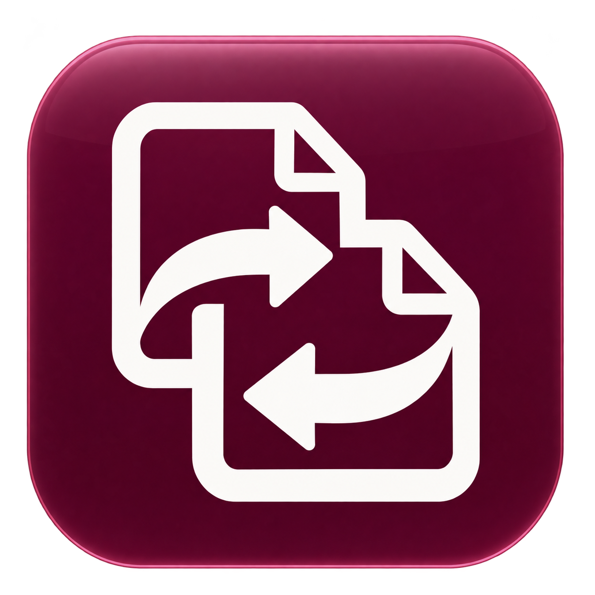

# Starlit DeskConvert

English · [Türkçe](README.tr.md)

Pull the audio out of a clip, shrink an image, or save the pages of a PDF as PNGs. I built DeskConvert for jobs like those. Right-click a file in Windows and pick a preset. The conversion runs on your PC and keeps the source file by default.

## Install and run

1. Install [Python 3.10 or later](https://www.python.org/downloads/windows/) and tick **Add Python to PATH** during setup.
2. Download and extract this repository, then double-click **Başlat.bat**. The first launch downloads dependencies. Conversions run offline after setup.
3. Select **Add to context menu** in the app. Right-click a file and open **Show more options → DeskConvert**.
4. Pick a preset. **MP3** extracts a video’s audio. **MP4 · Small file** makes a smaller copy. **Resize to 720p → MP4** scales the video down and keeps its aspect ratio.

For a batch, drag files into the app or use **Choose files**. Pick a target format and hit **Convert**. Use **Choose folder** to save elsewhere. If the filename already exists, DeskConvert adds a number to the new copy. Select a finished file in the queue and click **Show output** to find it in Explorer.

## What you can convert

| Files | Outputs and options |
| --- | --- |
| Video | MP4, MKV, WebM, OGV, AVI, and GIF. Scale to 75% or 25%, limit the height to 720p or 1080p, rotate, or extract audio. DVD VOB files also work. |
| Audio | MP3, AAC, Ogg, FLAC, and WAV. Set tempo, pitch, channels, sample rate, and bitrate. CDA needs the audio CD in the optical drive. |
| Images | PNG, JPEG, WebP, AVIF, ICO, and PDF. Camera RAW, PSD, XCF, DDS, EXR, and SVG also work as inputs. |
| Documents | Save PDF pages as separate images. For PDF or image output from Word, Excel, or PowerPoint files, install the corresponding Microsoft Office app. |
| Tables and archives | Pick from the available formats in the app, including CSV, XLSX, JSON, ZIP, TAR, and 7z. |

## Make a preset

Open **Manage presets**, duplicate a preset, and give it a name. Enter input extensions if you want it to show up for specific files. Set the quality, size, audio options, or destination. For example, **(p)Share/(f)** saves the result in a **Share** subfolder alongside the source, with the original basename.

| Token | Value |
| --- | --- |
| `(p)`, `(f)` | Source or selected folder and filename without its extension |
| `(i)`, `(o)` | Input and output extensions |
| `(n:i)`, `(n:c)` | Page index and total page count |
| `(p:d)`, `(p:m)`, `(p:v)`, `(p:p)` | Documents, Music, Videos, and Pictures |
| `(d0)`, `(d1)`, `(d:yyyy-MM-dd)` | Parent folder, the folder above it, and the date |

You can keep the source, send it to **Conversion Archives** or the Recycle Bin, or delete it permanently. DeskConvert asks for confirmation before recycling or deleting. It only applies the source action after verifying the output.

The preset window also lets you set how many jobs run at once, copy finished files to the clipboard, and check GitHub for updates. **Advanced FFmpeg options** accepts a supported set of output flags and filters.

## Good to know

- Click the preview or press **F3** to expand it. Videos play silently for up to 60 seconds. Audio previews play for up to 45 seconds.
- The classic menu takes one file. The signed Windows 11 extension can pass a batch through the main right-click menu. Toggle the menu off and back on if you move the app folder.
- Lossless conversion from a static 8-bit PNG to WebP verifies pixels and transparency. Animated and 16-bit PNGs are unsupported on that route.
- A standard video-to-GIF conversion uses 12 fps and a maximum width of 480 px. A preset can override the frame rate and size.
- H.264 hardware encoding needs a compatible GPU, driver, and FFmpeg encoder.

## Development

Once setup finishes, run the tests in PowerShell.

```powershell
.venv\Scripts\python.exe -m unittest discover
.venv\Scripts\python.exe -X utf8 selftest.py
```

Build the Windows 11 x64 extension with Zig 0.15.2 and MakeAppx from the Windows SDK. In an x64 Visual Studio Developer PowerShell, you can use `-Msvc` in place of `-Zig`.

```powershell
.\shell\build.ps1 -Zig C:\Tools\zig.exe -MakeAppx C:\Tools\makeappx.exe
.\shell\register.ps1 -SignTool C:\Tools\signtool.exe
```

The second command signs the MSIX in `shell\dist` and exports `ExplorerMenu.cer`. Once Windows trusts the certificate, run `.\shell\register.ps1` to register the extension for your account.

## License

DeskConvert is licensed under the **GNU General Public License version 3** (`GPL-3.0-only`). [Full license text](LICENSE).
