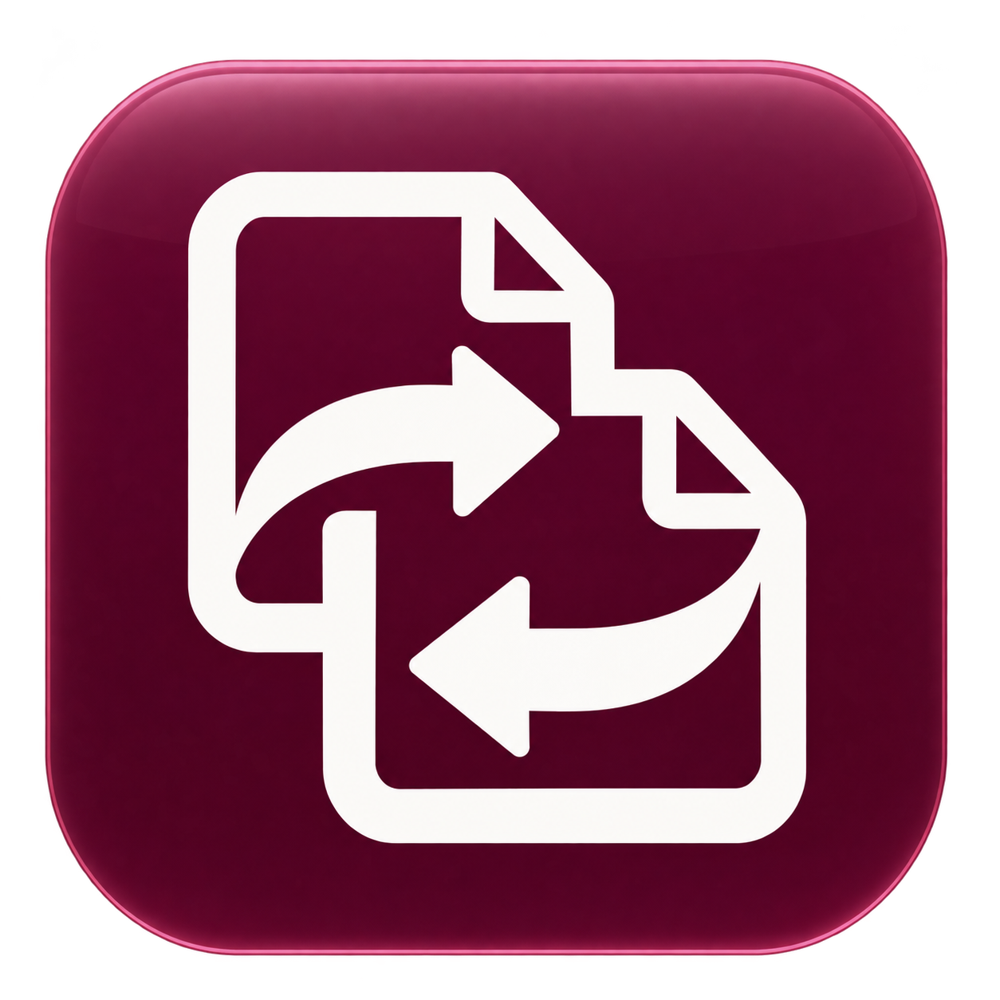
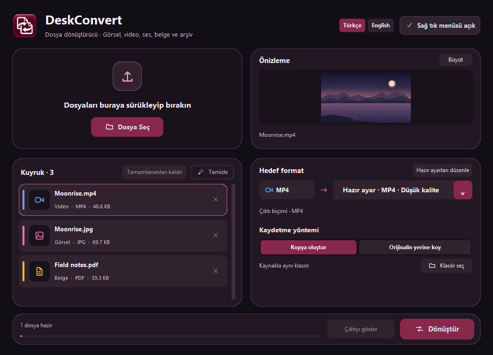
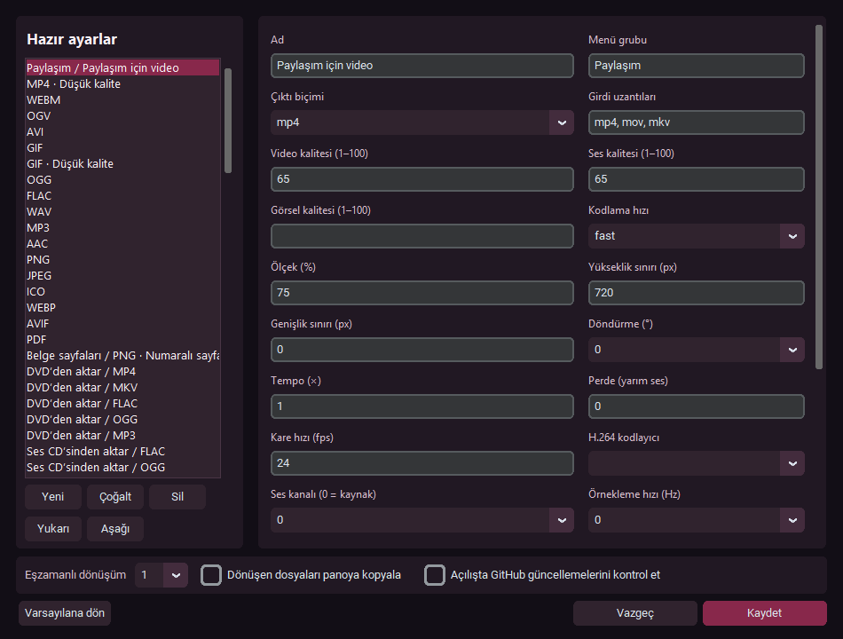
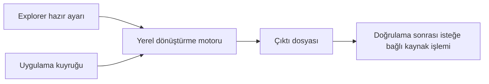

<div align="center">
  
  <h1>Starlit DeskConvert</h1>
  <p><strong>Windows’ta video, ses, görsel ve belgeleri sağ tıktan dönüştür.</strong></p>
  <p><a href="README.md">English</a> · <strong>Türkçe</strong></p>
  <p><a href="https://github.com/wiski-i/Starlit-DeskConvert/archive/refs/heads/main.zip"><strong>ZIP’i indir</strong></a> · <a href="#hızlı-başlangıç">Hızlı başlangıç</a> · <a href="#ekran-görüntüleri">Ekran görüntüleri</a> · <a href="#hazır-ayarlar">Hazır ayarlar</a></p>
  <p>
    
    
    
    <a href="LICENSE"></a>
  </p>
</div>

---

## Genel bakış

Bir videodan MP3 almak, bir görseli küçültmek ya da her PDF sayfasını ayrı PNG yapmak için DeskConvert’i aç. Sık yaptığın dönüşümü hazır ayar olarak kaydedersen bir sonraki sefer doğrudan sağ tık menüsünden çalıştırabilirsin.

## Ekran görüntüleri

| Dönüştürme kuyruğu |
| :---: |
|  |
| *Örnek video, görsel ve PDF dosyaları. Üstte önizleme, sağda hedef biçim ve kaydetme seçenekleri.* |

| Hazır ayar düzenleyicisi |
| :---: |
|  |
| *Paylaşım için örnek bir MP4 ayarı. Girdi türü, kalite, ölçek ve kare hızı aynı ekranda.* |


## Hızlı başlangıç

1. Windows’a [Python 3.10 veya üzerini](https://www.python.org/downloads/windows/) kur. Kurulumda **Add Python to PATH** seçeneğini işaretle.
2. Bu depoyu indir, ZIP’i aç ve **Başlat.bat** dosyasına çift tıkla. İlk açılışta bağımlılıklar indirilir. Sonraki dönüşümler çevrimdışı çalışır.
3. Uygulamada **Sağ tık menüsüne ekle**’ye bas. Sonra bir dosyaya sağ tıkla ve **Daha fazla seçenek göster → DeskConvert** menüsünü aç.
4. Bir hazır ayar seç. **MP3** videonun sesini alır. **MP4 · Düşük kalite** daha küçük bir kopya oluşturur. **720p’ye sığdır → MP4** görüntüyü oranını koruyarak küçültür.

Birden fazla dosyayı çevirmek için bunları uygulamaya sürükle veya **Dosya Seç**’i kullan. Hedef biçimi seçip **Dönüştür**’e bas. **Klasör seç** ile çıktı yerini değiştirebilirsin. Kayıt adı doluysa DeskConvert numaralı bir kopya oluşturur. Kuyruktan tamamlanan bir dosyayı seçip **Çıktıyı göster** ile Explorer’da açabilirsin.

## Neleri çevirebilirsin?

| Dosya | Çıktı ve işlemler |
| --- | --- |
| Video | MP4, MKV, WebM, OGV, AVI ve GIF. %75/%25 ölçek, 720p/1080p sınırı, döndürme ve ses çıkarma. DVD’den gelen VOB dosyaları da desteklenir. |
| Ses | MP3, AAC, Ogg, FLAC ve WAV. Tempo, perde, ses kanalı, örnekleme hızı ve bit hızı ayarlanabilir. CDA için ses CD’si optik sürücüde takılı olmalı. |
| Görsel | PNG, JPEG, WebP, AVIF, ICO ve PDF. Kamera RAW, PSD, XCF, DDS, EXR ve SVG de girdi olarak kullanılabilir. |
| Belge | PDF sayfalarını ayrı ayrı görsele çevir. Word, Excel ve PowerPoint dosyalarının PDF veya görsel çıktısı için ilgili Microsoft Office uygulaması gerekir. |
| Tablo ve arşiv | CSV, XLSX, JSON, ZIP, TAR ve 7z gibi mevcut biçimleri uygulamadaki hedef listesinden seç. |

## Hazır ayarlar

**Hazır ayarları düzenle**’yi aç, bir ayarı çoğalt ve ona bir ad ver. Belirli dosyalarda görünsün istiyorsan girdi uzantılarını gir. Kaliteyi, görüntü boyutunu, ses ayarlarını veya çıktı yerini değiştir. Mesela **(p)Paylaş/(f)** şablonu çıktıyı kaynak klasöründeki **Paylaş** alt klasörüne orijinal adıyla kaydeder.

Kaynak dosyayı tutabilir, **Conversion Archives** klasörüne taşıyabilir, Geri Dönüşüm Kutusu’na gönderebilir veya kalıcı olarak silebilirsin. DeskConvert silme ve geri dönüşüm için onay ister. Kaynak işlemi, çıktı başarıyla doğrulandıktan sonra çalışır.

Aynı pencereden eşzamanlı dönüşüm sayısını, panoya kopyalamayı ve GitHub güncelleme kontrolünü de ayarlayabilirsin. Belirli FFmpeg çıktı ve filtre seçenekleri **Gelişmiş FFmpeg seçenekleri** alanında kullanılabilir.

<details>
<summary>Çıktı yolu şablonları</summary>

| Şablon | Değeri |
| --- | --- |
| `(p)`, `(f)` | Kaynak ya da seçilen klasör ve uzantısız dosya adı |
| `(i)`, `(o)` | Girdi ve çıktı uzantıları |
| `(n:i)`, `(n:c)` | Sayfa numarası ve toplam sayfa sayısı |
| `(p:d)`, `(p:m)`, `(p:v)`, `(p:p)` | Belgeler, Müzik, Videolar ve Resimler |
| `(d0)`, `(d1)`, `(d:yyyy-MM-dd)` | Üst klasör, onun üstündeki klasör ve tarih |

</details>

## Nasıl çalışır?



<details>
<summary>Bilmen gerekenler</summary>

- Dosyaya tıklayarak önizleme açabilir, **F3** ile büyütebilirsin. Video önizlemesi sessiz olarak en fazla 60 saniye, ses önizlemesi en fazla 45 saniye oynatır.
- Klasik sağ tık menüsü tek dosya alır. İmzalı Windows 11 uzantısı toplu seçimi ana menüden açabilir. Kurulum klasörünü taşırsan sağ tık menüsünü kapatıp tekrar aç.
- Durağan 8 bit PNG’den WebP’ye kayıpsız dönüşüm pikseli ve saydamlığı doğrular. Hareketli veya 16 bit PNG bu yolda desteklenmez.
- Normal video → GIF dönüşümü 12 kare/sn ve en fazla 480 piksel genişlik kullanır. Hazır ayarlarla kare hızını ve boyutu değiştirebilirsin.
- H.264 donanım kodlaması için uyumlu GPU, sürücü ve FFmpeg kodlayıcısı gerekir.

</details>

## Geliştirme

<details>
<summary>Testler ve Windows 11 uzantısı</summary>

PowerShell’de kurulumdan sonra testleri çalıştırabilirsin.

```powershell
.venv\Scripts\python.exe -m unittest discover
.venv\Scripts\python.exe -X utf8 selftest.py
```

Windows 11 x64 uzantısını Zig 0.15.2 ve Windows SDK’daki MakeAppx ile derle. Visual Studio x64 Developer PowerShell’de `-Zig` yerine `-Msvc` kullanabilirsin.

```powershell
.\shell\build.ps1 -Zig C:\Tools\zig.exe -MakeAppx C:\Tools\makeappx.exe
.\shell\register.ps1 -SignTool C:\Tools\signtool.exe
```

İkinci komut `shell\dist` altındaki MSIX paketini imzalar ve `ExplorerMenu.cer` dosyasını çıkarır. Windows sertifikaya güveniyorsa `.\shell\register.ps1` ile uzantıyı mevcut hesabına kaydet.

</details>

## Lisans

DeskConvert, **GNU Genel Kamu Lisansı 3.0** (`GPL-3.0-only`) altında yayınlanır. [Tam lisans metni](LICENSE).
